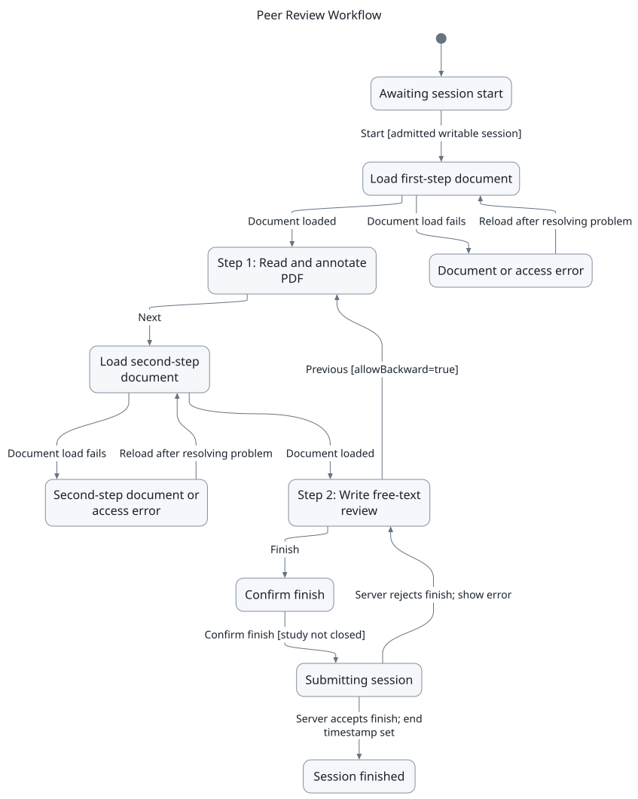
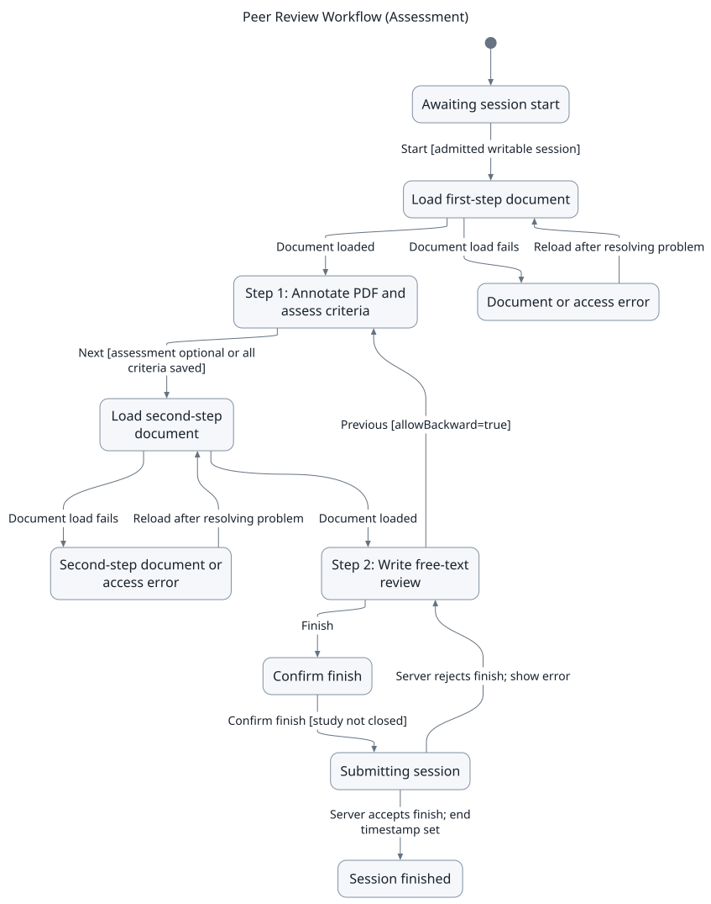
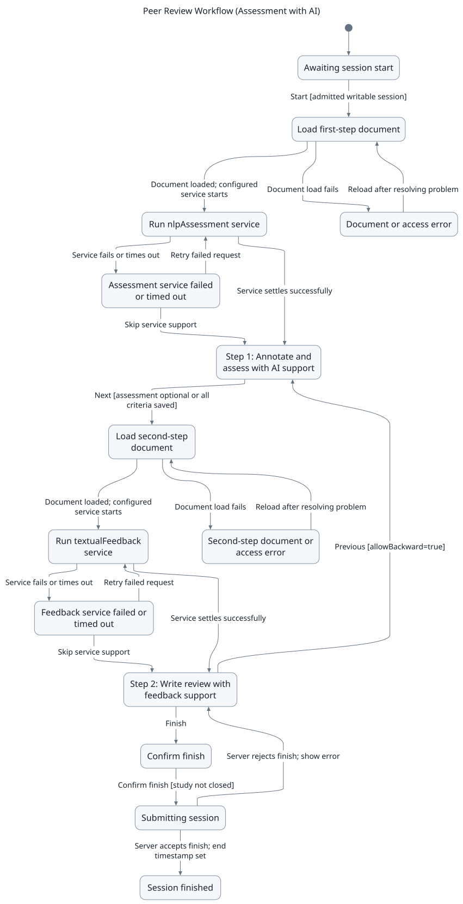
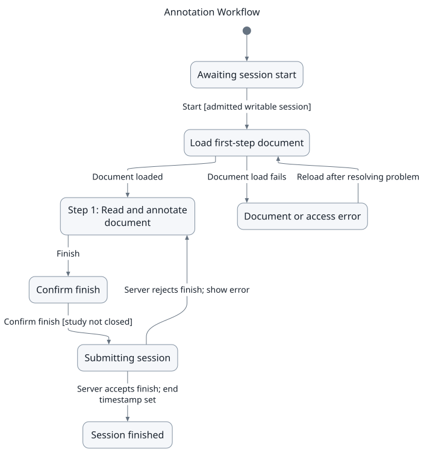
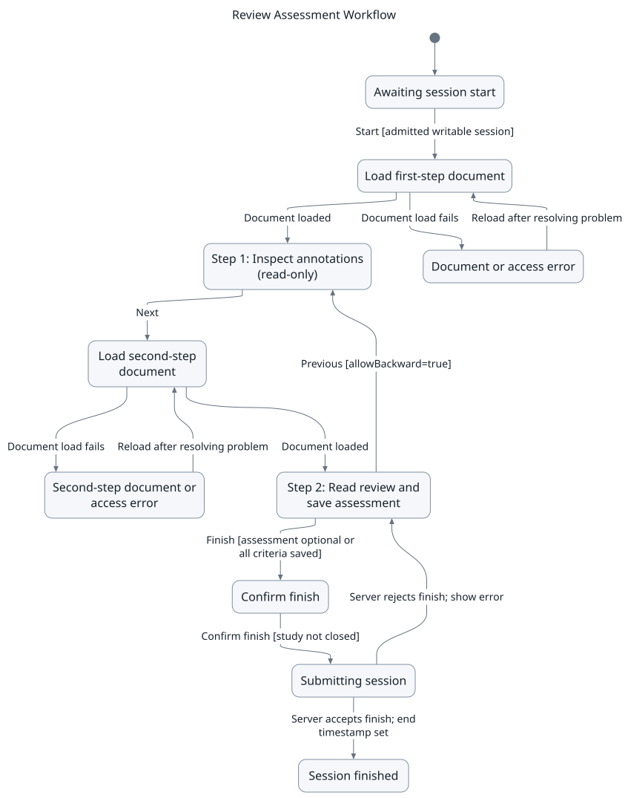
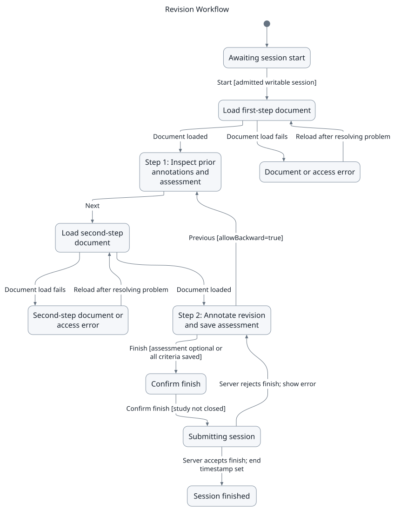
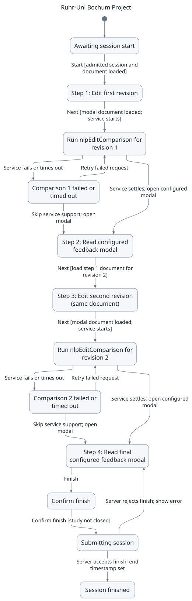
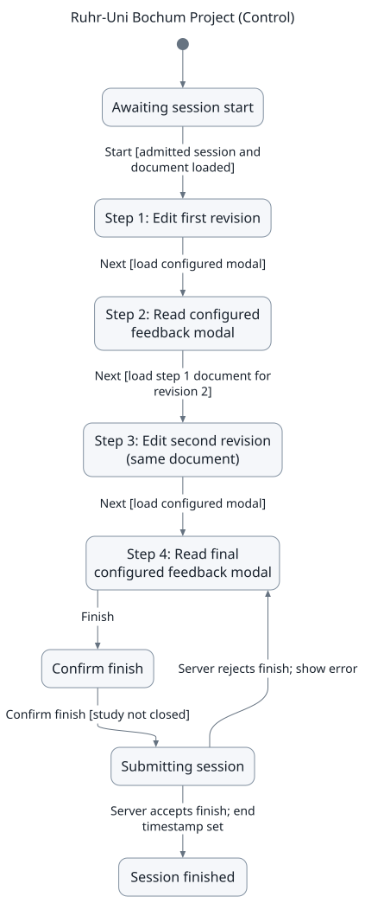

What is a Study?
================

In CARE, a **Study** is a controlled workflow that guides participants through a sequence of tasks, 
such as revising a document, annotating a PDF, or responding to AI-generated feedback.  
Studies are used in research settings to track how participants interact with documents and tools in a structured way.  

A study has two core parts: the **Study**, which defines the :ref:`workflow <workflows-and-steps>`, its steps, and options; 
and **Study Sessions**, which are the individual runs of the study for each participant, possibly at different times.  
Each participant creates a **study session** when they join a study via an invitation link. All edits, annotations, and 
interactions in that session are stored with a unique ``studySessionId``. Sessions are independent, allowing multiple 
participants to run the same study in parallel. Researchers can later analyze the data per session, including edits, 
annotations, and navigation behavior.  

.. note::

   Behaviour data (such as button clicks, scrolling, or sidebar toggling) are **only tracked if the user explicitly 
   accepted tracking in the consent form**. Without this consent, CARE does not log detailed interactions.

.. _workflows-and-steps:

Workflows and Steps
-------------------

A **workflow** defines the structure of a study.  
It consists of **steps**, where each step specifies:

- The **step type** (editor, annotator, or modal step).  
- Whether the participant may move **backward** to a previous step.  
- Any required **document** (HTML text or PDF).  
- Optional **step configuration**, which may include:
  
  - **services** (e.g., NLP feedback)  
  - placeholders  
  - modal appearance  

.. note::

   Be careful with the term *document*:  

   - In the **frontend**, the step definition tells CARE *which document should be opened* when that step runs.  
   - In the **database**, the step definition controls *whether a document is selectable* or *must come from another step’s output*.  
     For example, in the :ref:`Ruhr-Uni Bochum Project <ruhr-uni-bochum-project>`, the Step 3 editor is based on the results of the Step 1 editor rather than a newly chosen document.

Step Types
~~~~~~~~~~

- **Editor (Quill Editor)**  
  Used in workflows where participants write or revise text.  
  The editor tracks edits step by step, grouped by ``studySessionId`` and ``studyStepId``.  
  For background on the editor, see :doc:`../editor_usage`.

- **Annotator (PDF Viewer)**  
  Used in workflows where participants highlight, annotate, or comment on PDFs.  
  Annotations and comments are stored per session and per step, ensuring reproducibility.  
  The annotator provides features such as the sidebar, color-coded highlights, NLP support, and annotation downloads.  
  For technical details, see :doc:`Annotator <../../for_developers/frontend/components/annotator>`.

- **Modal Documents (Quill Editor with Placeholders)**  
  A modal document is rendered in a popup and cannot be edited directly by the participant.  
  Instead, it is dynamically filled with **placeholders** that are resolved at runtime.  
  This allows NLP results, comparisons, or step outputs to be displayed in a structured and visual way.

Placeholders
------------

Placeholders are only relevant for **Modal steps** (Step Type = 3).  
They allow inserting dynamic content such as text, charts, or comparisons into read-only modal documents,  
optionally powered by NLP skills.

For details on how to configure and use placeholders, see :doc:`Step Modal <../../for_developers/frontend/components/stepmodal>`.

.. _current-available-workflows:

Current Available Workflows
---------------------------

The following predefined workflows specify the order of tasks in a study.
You select the documents, assessment configurations, and services when creating the study.
For information on copying or customizing a workflow, see :doc:`../workflow_management`.

**Step types**:

- ``1 = Annotator``: read, highlight, or comment on a PDF.
- ``2 = Editor``: write or revise text in the Quill editor.
- ``3 = Modal``: read configured content, optionally including placeholders for service results.

The state charts show the participant's progress, including loading, service failures,
and finish confirmation. They assume the participant has access to an open study.
Study deadlines, changes to access, and continuation after a finished session are not shown.
Open the SVG download to inspect a chart at full size without losing image quality.

.. note::

   Assessment workflows require an assessment configuration for the relevant step.
   **Forced Assessment** is disabled by default. When enabled, participants must save
   a score and justification for each named criterion before moving forward from that step.
   AI suggestions and scores copied from a previous step do not count as saved assessments
   until the participant saves them.

**Peer Review Workflow**
~~~~~~~~~~~~~~~~~~~~~~~~

*Based on the EiWA Project: participants annotate a PDF and write a free-text review.*

- **Step 1 - Annotator:** Read and annotate the PDF.
- **Step 2 - Editor:** Write the review in a separately selected editor document.
  Participants can return to Step 1 using **Previous**, then continue to Step 2.

This workflow has no predefined assessment or AI service. After writing the review,
participants select **Finish** and confirm submission.

   Peer Review Workflow: annotation followed by review writing.

:download:`SVG <workflow-charts/peer-review/chart.svg>`,
:download:`PNG <workflow-charts/peer-review/chart.png>`,
:download:`Mermaid source <workflow-charts/peer-review/chart.mmd>`

-----

**Peer Review Workflow (Assessment)**
~~~~~~~~~~~~~~~~~~~~~~~~~~~~~~~~~~~~~

*Adds a structured assessment to the PDF annotation step.*

- **Step 1 - Annotator and assessment:** Read and annotate the PDF, then enter scores
  and justifications using the selected assessment configuration.
- **Step 2 - Editor:** Write a free-text review in a separately selected editor document.
  **Previous** returns to Step 1.

When **Forced Assessment** is enabled for Step 1, all criteria must be saved before
**Next** opens the editor. Step 2 has no predefined assessment or AI service.

   Peer Review Workflow (Assessment): assess the PDF before writing the review.

:download:`SVG <workflow-charts/peer-review-assessment/chart.svg>`,
:download:`PNG <workflow-charts/peer-review-assessment/chart.png>`,
:download:`Mermaid source <workflow-charts/peer-review-assessment/chart.mmd>`

-----

**Peer Review Workflow (Assessment with AI)**
~~~~~~~~~~~~~~~~~~~~~~~~~~~~~~~~~~~~~~~~~~~~~

*Adds AI support to structured assessment and review writing.*

- **Step 1 - Annotator and assessment:** The configured ``nlpAssessment`` service
  provides support for assessing the PDF. Participants review its output, annotate
  the PDF, and save their own assessment.
- **Step 2 - Editor:** The configured ``textualFeedback`` service supports review writing.
  **Previous** returns to Step 1. This step reuses the document selected for Step 1.

Select the skills or AI hooks, input mappings, and output handling during study setup.
If a service fails or times out, participants can retry it or skip service support.
Skipping a service does not waive the assessment condition when **Forced Assessment** is enabled.
For more information about AI configuration, see :doc:`../ai_features`.

   Peer Review Workflow (Assessment with AI): service support at both steps.

:download:`SVG <workflow-charts/peer-review-ai/chart.svg>`,
:download:`PNG <workflow-charts/peer-review-ai/chart.png>`,
:download:`Mermaid source <workflow-charts/peer-review-ai/chart.mmd>`

-----

**Annotation Workflow**
~~~~~~~~~~~~~~~~~~~~~~~

*A single-step workflow for PDF annotation tasks.*

- **Step 1 - Annotator:** Read, highlight, and comment on the PDF, then select **Finish**
  and confirm submission.

There is no second step, backward navigation, predefined assessment, or predefined AI service.

   Annotation Workflow: one PDF annotation step.

:download:`SVG <workflow-charts/annotation/chart.svg>`,
:download:`PNG <workflow-charts/annotation/chart.png>`,
:download:`Mermaid source <workflow-charts/annotation/chart.mmd>`

-----

**Review Assessment Workflow**
~~~~~~~~~~~~~~~~~~~~~~~~~~~~~~

*Supports assessment of an existing review or submitted study session.*

- **Step 1 - Annotator, read-only:** Inspect the source PDF and its visible annotations
  without changing them. **Show All Document Annotations** controls whether default
  document annotations are included.
- **Step 2 - Editor, read-only, with assessment:** Inspect the review content and save
  scores and justifications in the assessment sidebar. The editor content remains read-only.
  **Previous** returns to Step 1.

The second step is linked to Step 1. Select its assessment configuration during study setup.
When **Forced Assessment** is enabled for Step 2, all criteria must be saved before **Finish**.

   Review Assessment Workflow: inspect existing content and assess it.

:download:`SVG <workflow-charts/review-assessment/chart.svg>`,
:download:`PNG <workflow-charts/review-assessment/chart.png>`,
:download:`Mermaid source <workflow-charts/review-assessment/chart.mmd>`

-----

**Revision Workflow**
~~~~~~~~~~~~~~~~~~~~~

*Supports review of a previous submission followed by assessment of a revised submission.*

- **Step 1 - Annotator and assessment, read-only:** Inspect the previous document,
  annotations, and assessment without changing them.
- **Step 2 - Annotator and assessment:** Annotate the revised document and save a new
  assessment. Scores from Step 1 can prefill this assessment, but remain unsaved until
  the participant saves them. **Previous** returns to Step 1.

Select a document and assessment configuration for each step. Step 2 does not automatically
reuse the first document. When **Forced Assessment** is enabled for Step 2, all criteria
must be saved before **Finish**. The chart assumes the default optional assessment in
read-only Step 1.

   Revision Workflow: compare prior work with a separately selected revision.

:download:`SVG <workflow-charts/revision/chart.svg>`,
:download:`PNG <workflow-charts/revision/chart.png>`,
:download:`Mermaid source <workflow-charts/revision/chart.mmd>`

-----

**Ruhr-Uni Bochum Project**
~~~~~~~~~~~~~~~~~~~~~~~~~~~

*Studies revision behavior over two editing rounds with AI-supported feedback between them.*

- **Step 1 - Editor:** Write or revise the initial text.
- **Step 2 - Modal:** Run the configured ``nlpEditComparison`` service and display the
  prepared modal content.
- **Step 3 - Editor:** Revise the text again using the document and edits from Step 1.
- **Step 4 - Modal:** Run ``nlpEditComparison`` again and display the final modal content,
  then select **Finish** and confirm submission.

Backward navigation is disabled for every step. Configure the service inputs, output handling,
and modal placeholders to display comparisons or feedback. A successful service request alone
does not determine what the modal displays. Failed or timed-out requests can be retried or skipped.

For a detailed setup example, see :ref:`Ruhr-Uni Bochum Project <ruhr-uni-bochum-project>`.

   Ruhr-Uni Bochum Project: two revisions with configured service support.

:download:`SVG <workflow-charts/bochum/chart.svg>`,
:download:`PNG <workflow-charts/bochum/chart.png>`,
:download:`Mermaid source <workflow-charts/bochum/chart.mmd>`

-----

**Ruhr-Uni Bochum Project (Control)**
~~~~~~~~~~~~~~~~~~~~~~~~~~~~~~~~~~~~~

*Uses the same four-step structure as the Ruhr-Uni Bochum Project without predefined AI services.*

- **Step 1 - Editor:** Write or revise the initial text.
- **Step 2 - Modal:** Read the prepared modal content without an automatic AI request.
- **Step 3 - Editor:** Revise the text again using the document and edits from Step 1.
- **Step 4 - Modal:** Read the final prepared modal content, then select **Finish**
  and confirm submission.

Backward navigation is disabled for every step. The modals can contain instructions or other
prepared content. They are not necessarily empty. This workflow provides a control condition
without the predefined comparison services.

   Ruhr-Uni Bochum Project (Control): two revisions without predefined service support.

:download:`SVG <workflow-charts/bochum-control/chart.svg>`,
:download:`PNG <workflow-charts/bochum-control/chart.png>`,
:download:`Mermaid source <workflow-charts/bochum-control/chart.mmd>`

Creating a Study
----------------

This section describes how to create a new study in CARE.  
It includes preparing documents, adding placeholders, and defining the workflow.

Login and Document Preparation
~~~~~~~~~~~~~~~~~~~~~~~~~~~~~~

1. Login to CARE using your username and password.  

2. Go to ``/dashboard/documents``. Click ``Add`` to upload a new pdf document which will be usable via the Annotator or click on ``Create`` to add a new document, which you will be able to customize in the next part.  

3. Choose a document type if you clicked on ``Create``:  

   - **General Editor Document**: Opens a plain editor. Can be used for preparatory steps like the first revision.  
   - **Study Modal Document**: Required for steps where dynamic placeholders are used. Name it clearly for later reference.  

.. note::

   Only **Study Modal Documents** can be used in modal steps (e.g., steps with placeholders).  

4. Once created, documents appear in the list. Use the icons on the right to access, delete, publish, or edit names.  

5. To insert placeholders in case of a **Study Modal Document**, open the document editor:  

   - Click where the placeholder should be added.  
   - Choose the placeholder type (text, chart, comparison).  
   - CARE auto-numbers placeholders to preserve order.  

6. After preparing all documents, click ``Go Back...`` to return to the documents page.  

Creating the Study
~~~~~~~~~~~~~~~~~~

7. Navigate to ``/dashboard/studies``.  

8. Click “Add” to open the study creation form.  

   - Fill in the **name** (required) and **description** (required). You can also customize: 
        - **duration**
        - **number of study sessions in general**
        - **number of study sessions per user**
        - **the study being collaborative**
        - **anonymization of comments**
        - **resumability**
        - **multible submissions** 
        - **start and end date and time**

   - Select a **workflow** (required). See workflows here: :ref:`workflows <current-available-workflows>`
   - Assign documents to steps (required). For editor and annotator steps, select the document to be edited or annotated. For modal steps, select the prepared **Study Modal Document** with placeholders.  

9. Save the study. Click ``Copy Link`` to share the invitation link with participants.  

.. note::

   Participants joining through this link will automatically start a new **Study Session**.

Working with Study Templates
~~~~~~~~~~~~~~~~~~~~~~~~~~~~~

Study templates allow you to reuse study configurations for future studies, saving time and ensuring consistency.

.. note::

   **Study templates** (saved study configurations) are different from **email and document content templates**, which define the text of emails (e.g. password reset, session links) and pre-filled document content. For content templates, see :doc:`Email and Document Templates <../templates>`.

**Creating Templates:**

You can create a template in two ways:

1. **From an existing study:**
   
   - After creating and saving a study, locate it in the studies list
   - Click on ``Save as template`` to convert the study configuration into a reusable template

2. **Directly from the Saved Templates modal:**
   
   - Navigate to ``/dashboard/studies``
   - Click the ``Saved Templates`` button
   - In the modal, click ``Create Template``
   - Define the workflow, settings, and document assignments
   - Save to create a new template without creating a full study first

**Using Templates:**

- Click ``Saved Templates`` to view all your saved templates
- Browse available templates with their configuration details (resumable, collaborative, multiple submissions, etc.)
- Click the ``Use`` button (play icon) on any template to create a new study based on that template
- The template's workflow and settings will be pre-filled, which you can then customize as needed

**Managing Templates:**

- Templates can be deleted from the Saved Templates modal (requires appropriate permissions)
- Templates are marked with the ``template`` flag and remain separate from active studies

Creating Assignment-Based Studies
~~~~~~~~~~~~~~~~~~~~~~~~~~~~~~~~~~

CARE supports creating studies based on specific documents or imported submissions (e.g., from Moodle). This is particularly useful for peer review workflows or grading scenarios where you want to assign specific studies to reviewers.

**Single Assignment**

To create a study with a single assignment:

1. Navigate to ``Studies`` in the Dashboard
2. Click ``Add Single Assignment``
3. Select a study template (required)
4. Choose the assignment type:

   - **Documents**: Select from documents marked as ready for review
   - **Submissions**: Select from imported submissions (e.g., imported either from Moodle or manual inclusion)

5. Select the specific document or submission
6. Select one or more reviewers from the user list
7. Review and confirm the assignment details

**Bulk Assignments**

To create multiple assignments simultaneously:

1. Navigate to ``Studies`` in the Dashboard
2. Click ``Add Bulk Assignments``
3. Select a study template (required)
4. Choose the assignment type **Documents** or **Submissions**
5. Select multiple files from the table

   - Use filters and search to find specific details in the table
   - For submissions, you can filter by ``Group ID`` to organize assignments
6. Select reviewers

   - You can filter to show only users with documents
   - Filter to show only users from the selected documents/submissions
7. Configure the reviewer assignment strategy:

   **Role-based selection:**
   
   - Define how many reviews each user role should perform per file
   - Useful for distributing work evenly across teaching assistants, tutors, etc.
   - The system will automatically assign studies based on role quotas

   **Reviewer-based selection:**
   
   - Manually distribute documents among selected reviewers
   - Specify exactly how many documents each reviewer should handle
   - Total assignments must match the number of selected documents/submissions
8. Review the assignment summary showing total reviews to be created
9. Confirm to create all assignments

.. note::

   When creating bulk assignments with role-based selection, CARE automatically avoids assigning users to review their own documents or submissions.

.. tip::

   For Moodle-integrated workflows, see :doc:`Moodle Usage <../moodle_usage>` for details on importing submissions and publishing feedback back to Moodle.
